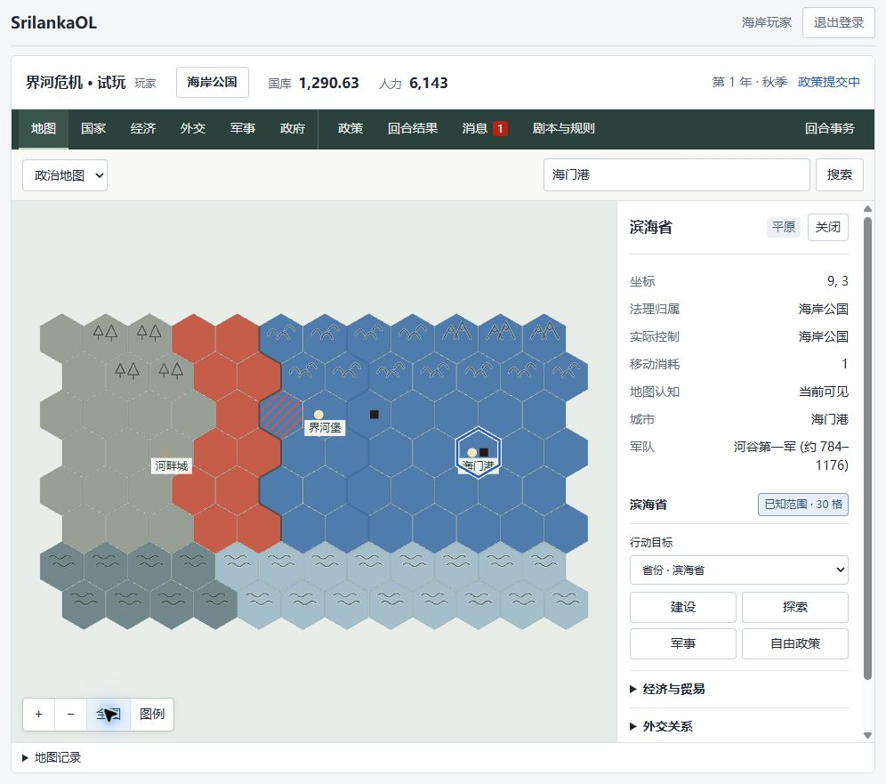
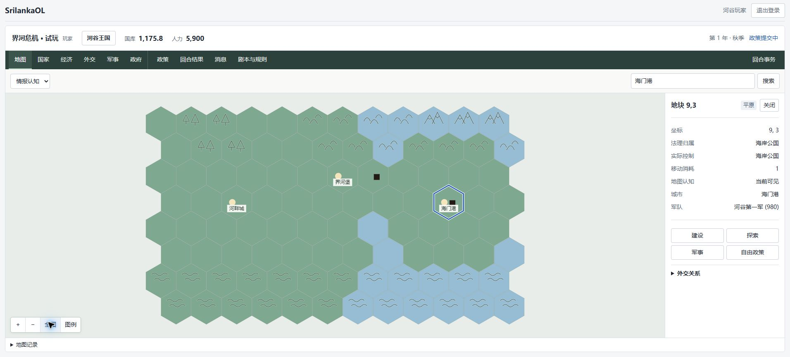
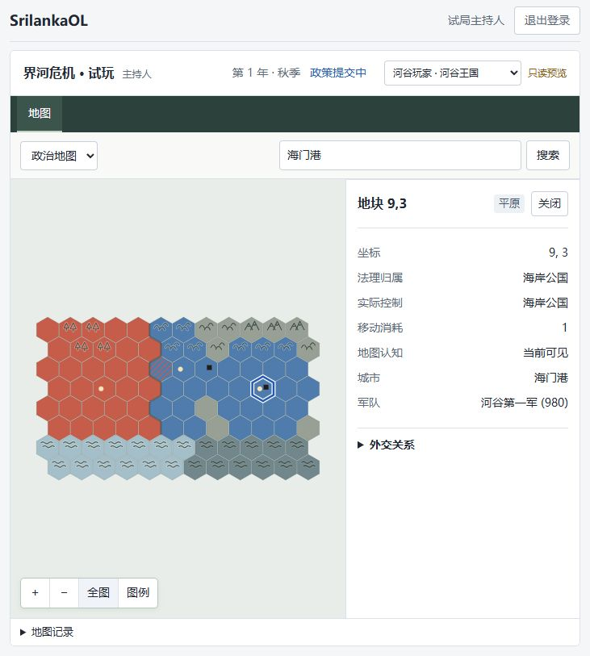
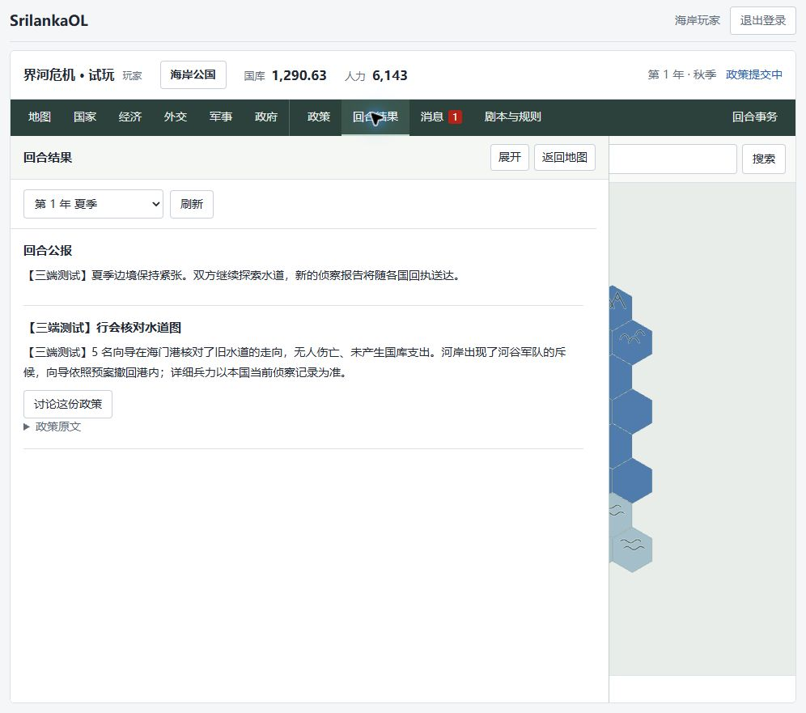

# 三浏览器验收记录

日期：2026-10-17。地址为本机 `http://localhost:15173/`，使用“界河危机 · 试玩”独立数据库。此次直接操作了三个已登录的真实浏览器标签页，没有用接口演练代替页面操作。

| 浏览器 | 身份 |
| --- | --- |
| Codex 内置浏览器 | 试局主持人 |
| Edge | 河谷玩家 / 河谷王国 |
| Chrome | 海岸玩家 / 海岸公国 |

## 实际操作结果

| 检查项 | 结果 |
| --- | --- |
| 本土和边境视野 | 未被占领本土保持当前可见；境外远处保留旧地理。军队周边提供两格探测 |
| 外国行政信息 | 河谷查看界河堡只得到界河省已知 4 格；主持人真实视角为 12 格。海门港被侦察后，河谷仍只看到地块名称，没有自动取得滨海省行政范围 |
| 占领条纹 | 渡口 5,2 仍以海岸法理归属为底色、河谷控制为条纹 |
| 地图模式 | 政治、地形和情报认知可切换，地形纹样保留，平原无额外符号；搜索定位和全图按钮可用 |
| 地图进入政策 | 从界河省进入探索政策，地图目标和类别带入；切换经济再返回政策，未保存文字和目标仍在 |
| 正式提交 | 两国各创建并正式提交一份带“【三端测试】”标题的政策；各玩家只看到本国政策 |
| 追问与沟通 | 主持人退回海岸政策，玩家从关联讨论回复 5 名向导、预算 0、撤退方案，再修改正文并第二次正式提交；主持人读到新正文和两次提交记录 |
| 主持人审核 | 两份政策批准后进入结算。反馈、军队移动、公报、经济账单均通过页面填写与保存 |
| 发布前隔离 | 结算草稿保存后，河谷军事页仍显示第一军 980 人在 5,2；海岸结果页显示尚未发布，没有草稿反馈 |
| 统一发布 | 发布后第一军从 5,2 移至 9,3，海门港法理归属和实际控制仍为海岸；移动本身不造成占领 |
| 军队情报 | 河谷在海门港看到本军精确 980 人，海岸看到约 784–1176 人。空驻地显示“无” |
| 结果权限与定位 | 河谷只显示侦察反馈，海岸只显示向导反馈；从结果中的界河省目标可以跳到地图并返回结果 |
| 主持人预览 | 河谷只读预览与 Edge 真实账号的海门港地块、980 人军队和外国行政信息限制一致；预览不提供编辑操作 |
| 界面操作 | Chrome 约 995 像素宽窗口中，调整后的地块行动按钮无需滚过折叠资料即可看到；没有添加额外说明组件 |
| 重载 | 三端重载后账号仍在、已结算状态保留、秋季政策已开放；重载后的检查未记录到页面 error/warn |

## 本轮发现并修复

1. **主持人收不到新政策列表**：一直打开的审核列表原先停在“暂无行动”。现在前台每五秒同步列表，回到面板或浏览器前台也会刷新；所选政策的退回、重新提交、批准、完成状态一起更新。正在编辑、保存或确认提交时，不用远端内容覆盖本地输入。隐藏面板停止轮询。
2. **结果页与顶部状态不一致**：玩家等待期间，顶部已显示“已公布”，正文仍停留“尚未发布”。现在收到回合状态或世界版本更新时，自动重读结果，主持人未保存的反馈继续保留。
3. **当前可见的空地块显示“军队：未获知”**：改为“无”；视野外缺少信息的地块仍保留“未获知”。
4. **常用行动入口埋在资料底部**：把行动目标和建设、探索、军事、自由政策按钮移到省份资料折叠项前面，避免每次先向下滚动。
5. **玩家返回按钮名称混淆**：从回合结果定位地图后显示“返回回合结果”，主持人仍显示“返回结算”。

## 当前试玩状态

停在第 1 年秋季，已开放政策提交。春季与夏季可以通过回合选择器回看。

| 项目 | 河谷王国 | 海岸公国 |
| --- | --- | --- |
| 国库 | 1,175.8 | 1,290.63 |
| 人力 | 5,900 | 6,143 |
| 军队 | 第一军 980，9,3 | 守备军 780，7,2 |

夏季新增的两份政策均为测试内容。侦察不收额外费用，仅执行正常季度经济账单；没有新增占领、战争、条约或政府改革。春季的渡口占领、战争和水利制度继续存在。服务保留运行。

## 自动回归

- Web 全量：26 个文件、127 项通过，新增回归覆盖新政策到达、补充请求解锁、草稿保护、隐藏面板、跨季完成状态、结果自动更新和结算反馈保护。
- Web TypeScript / 生产构建通过；本轮修改的 TypeScript 文件 ESLint 通过。
- 构建仍有既有的单包超过 500 kB 提示。
- 本轮未修改接口和数据库结构，没有重跑会清库的接口集成测试；前一轮接口测试结果见《界河危机验收记录》。

此次验证范围是本机三个浏览器的完整政策与结算流程，以及地图信息和常用操作。没有进行手机视口、真实互联网延迟或大地图压力测试。

## 截图

海岸玩家政治地图与前移后的常用操作入口：

河谷玩家侦察后的情报认知地图：

主持人只读预览：

海岸玩家的夏季私人反馈：

