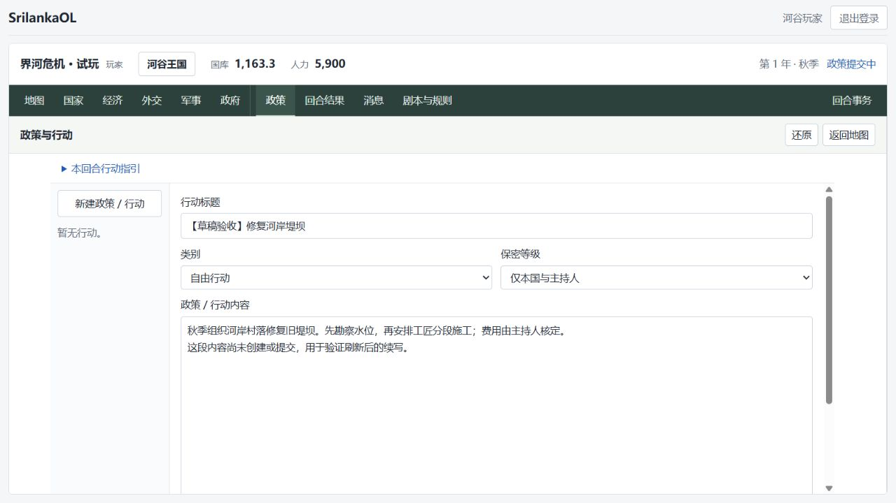
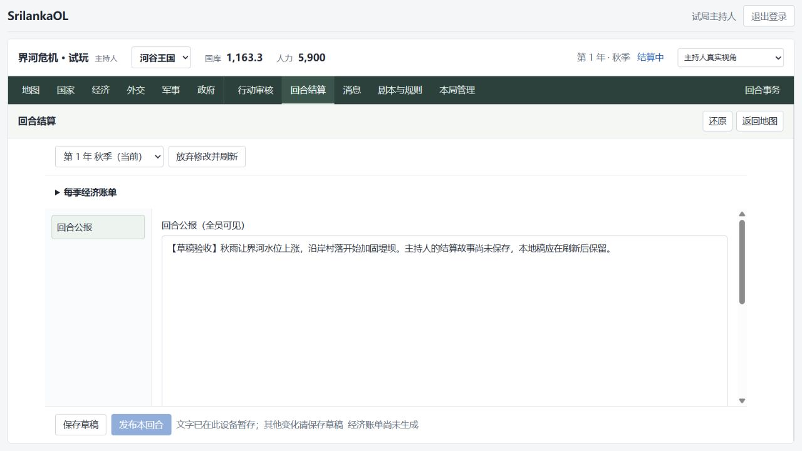

# 文字草稿续写验收

日期：2026-10-19。

## 已覆盖

- 未创建的政策：标题、正文、类别、保密设置和地图引用暂存在本设备；重新进入时选择“继续编写本地稿”，不会自动创建或提交。
- 已存在的政策：保留尚未获得服务器确认的改动。自动保存失败时，后台轮询不再替换编辑中的失败草稿；成功确认保存后才清除本地副本。
- 结算文字：保留公报和逐份政策反馈，恢复时与服务器结算版本、当前回合和阶段核对。恢复不修改已保存的数值或地图计划，也不自动保存或发布。
- 未发送消息：取得该会话的服务器读取权限后恢复到原会话。断线重试的请求标识保留到发送确认，刷新或重新登录后也复用该标识。

记录按账号、游戏、回合和对象隔离。消息属于跨季会话，按账号／游戏／会话隔离。旧回合中尚未创建的政策仍可查看和复制，不会作为新回合政策直接恢复。

服务器版本或阶段已经变化时，只提供“查看本地稿”和复制，不用本地旧稿覆盖服务器。两个页面编辑同一份本地稿时，旧页面不能覆盖或清除另一个页面的新内容。读取或写入失败会提示保留／复制文字，不显示虚假的已保存状态。

本地暂存与正式保存有明确区别：政策创建和提交、消息发送、结算保存和发布均保留原来的显式操作。结算页面说明“文字已在此设备暂存；其他变化请保存草稿”。

## 验证

页面全量回归：30 个文件、156 项通过。覆盖未创建政策重载、失败自动保存恢复与确认后清除、账号隔离、旧季仅复制、服务器新版保护、结算文字恢复、消息丢失响应后的同标识重试、会话权限丢失、存储不可用及两页面冲突。

在独立库 `srilanka_restore_corrections_20261018` 使用 API 18100、页面 15175 验收：

1. 河谷玩家填写尚未创建的政策，刷新后恢复标题和全文，没有创建服务器政策。
2. 换为海岸玩家，没有出现河谷的本地草稿。
3. 海岸玩家在原有政策会话中输入未发送消息，刷新并重开会话后恢复，未实际发送。
4. 主持人将独立副本的秋季推进至结算，填写公报但不保存；在另一个全新页面恢复文字，仍未保存或发布。

原试玩库保持秋季政策提交阶段，河谷国库 1175.80、人力 5900，海岸国库 1290.63、人力 6143，没有写入更正记录。测试只改动独立副本与验收网址下的本地草稿。

## 边界

本地副本属于本设备、当前浏览器和网址，不跨设备同步。浏览器清除站点数据后无法恢复本地稿。服务器正式保存与数据库备份仍是长期存档依据。

结算本地稿只保留长文字，结构化计划需通过“保存草稿”交给服务器。主持人独立整理稿、发布更正表单、规则与配置表单尚未接入本地恢复。

新建政策的接口目前没有跨刷新的创建请求幂等标识。若创建请求返回不确定的网络错误，重新创建前应先核对政策列表；本地恢复不会自动重新创建。
