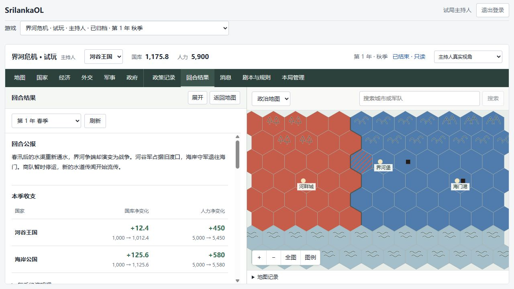

# 游戏结束与历史归档验收

日期：2026-10-18。

## 使用流程

1. 主持人进入“本局管理”，点击“结束本局”。
2. 填写结束说明，保存需要保留的稿件，再确认结束并归档。
3. 旧局显示“已结束 · 只读”，主持人可以新建一局。存在其他活动游戏时，服务器不会再允许新建。
4. 有多场可访问游戏时，顶部下拉菜单按“当前游戏”和“历史游戏”分组切换。

结束只冻结游戏，不推进季度、不自动执行尚未发布的结算，也不会公开秘密信息。历史地图保留各账号原有的情报范围；政策、私聊和结算继续按原权限读取。成员分配、地图编辑、国家调整、规则修改、政策提交、结算发布和消息发送均不能再改动旧局。已读游标和账号登录属于个人使用记录，仍可更新。

新局当前采用新的国家名单与开局准备，不自动复制旧局的中途状态、成员或剧本。归档后的业务内容不提供网页重开入口。

## 实现

- `POST /api/v1/games/:gameId/end`：主持人权限、当前回合/阶段校验、结束说明、幂等重试。
- `games` 保存结束时间、操作者和说明；`game_lifecycle_history` 保存状态变化及最后回合。
- 当前季度保留原状态，游戏的归档状态决定只读，不伪造一次正常回合结算。
- 归档与同时保存的业务事务互斥。有人正在写入或持有游戏编辑锁时返回可重试冲突，不等待形成循环锁。
- 数据库迁移 `024_game_ending_and_read_only.sql` 为现有带 `game_id` 的业务表增加只读保护，涵盖旧页面和直接服务调用。后续新增业务表需要复用同样的触发器。
- 页面关闭编辑入口并显示历史记录；其他窗口通过既有游戏刷新获取归档状态。
- `/me` 返回是否允许新建，避免只知道自己旧局的玩家看到无效的新建入口。

## 验证

- 完整接口回归：21 个文件、105 项通过。其后新建入口的全服可用性联动另行回归游戏生命周期与账号/游戏接口。
- 页面回归：28 个文件、139 项通过，覆盖结束确认、失败后重试、历史政策、只读私聊及新建入口显示。新建入口联动调整后，另行回归生命周期与账号/游戏接口共 7 项通过。类型、格式、ESLint 和 API/Web 构建检查通过。
- 专项接口验证：普通玩家与局外人不能结束；阶段变化拒绝旧确认；结束重试不重复记录；旧局仍可读；写入被拒绝；新局不继承旧成员权限；未结束的事务与旧快照都不能越过冻结限制。
- 修正两处旧测试夹具：不再重新打开已结束游戏，或向已经归档的外部游戏补写省份数据。

## 浏览器演练

演练使用独立数据库 `srilanka_restore_lifecycle_20261018`，由当前试玩备份恢复并迁移。页面临时使用 `127.0.0.1:15174` 和独立 API 端口；原试玩继续使用 `localhost:15173`。

在副本中已实际完成：主持人确认结束 → 新建“【隔离验收】下一局” → 返回旧局春季结算 → 玩家重新登录查看归档地图与私聊。旧局显示只读，仍能看到历史公报和原账目；玩家没有发送框，也不会因为没加入新局而误见新建入口。

原库 `srilanka_playtest_20261016` 未执行结束或另开一局，仍保留原来的秋季政策提交阶段。迁移前已备份：`20261018T120753323Z-45ce800f8293`。

另外对包含归档旧局和新局的副本进行了备份恢复：备份 `20261018T122951391Z-a09605581421`，恢复目标 `srilanka_restore_archive_verify_20261018`。51 张表、521 行内容摘要全部一致，24 项迁移校验通过；恢复后旧局仍是 Archived，新局仍是 Preparing，结束记录仅一条，说明与操作者记录完整。
