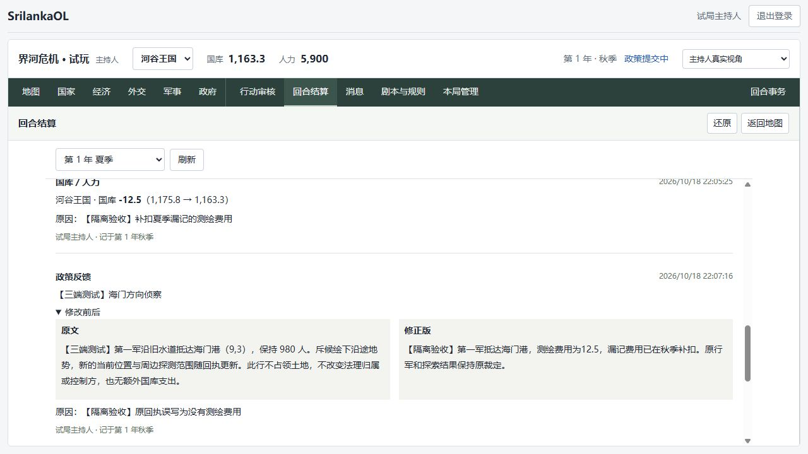

# 结算更正与即时编辑验收

日期：2026-10-18。

## 使用

主持人在“回合结算”选择已发布的回合，在底部点“更正已发布结果”。一次选择一项更正，填写原因，核对后发布：

- 公报文字：替换显示的全文，保留更正前后的文字，所有成员可查。
- 政策反馈：选择该季政策，替换反馈全文，仅主持人与所属国家玩家可查。
- 国库／人力：输入有正负号的补正增减值，展示当前余额与补正后余额；正式账目记入实际操作时的当前季。
- 军队兵力：读取当前兵力，填写修正值；修改真实军队、更新地图版本和视野，记录前后值。仅所属国家玩家和主持人收到精确更正记录。

原发布快照及原收支汇总保留。页面主文显示经过历次更正后的文字，底部记录按顺序展示。数值修正以前的结算时，补正针对当前余额／兵力，避免覆盖后续季的正常变化。更正记录在数据库中只许追加。

有权限查看的历史回合会标注“已更正”。当前季尚未发布时可点“查看最近更正”；非编辑中的结果每五秒刷新。没有权限的更正也不会泄露回合标记或时间。

## 即时地图操作

第一次开放游戏之前保留地图布置与单位创建。游戏运行以后，直接修改地块、批量编辑、创建城市／军队或直接移动需要“即时更正”，填写原因后才出现相应控制或允许提交，并校验地图版本。改动立即生效、刷新视野并记录原因和前后状态。

普通移动、占领、战损、征募和补兵仍在回合结算中准备，统一发布。探索计划仍从政策进入，保留发布时交付的流程。已经结束／归档的游戏不开放更正。

## 自动验证

接口全量回归：22 个文件、111 项通过；后续补充版本与阶段保护后，结算更正、游戏结束与原结算的 15 项针对性回归于 2026-10-19 再次通过。

- 接口覆盖连续文字更正与原快照不变、私人反馈隔离、当前季账目、重复／并发重试、请求标识复用冲突、余额和地图版本冲突、无效数值、外来政策、非主持人和归档限制。
- 兵力修正写入地图审计并更新版本和视野，其他国家和观察者不接收精确兵力记录。
- 补扣旧季费用后，当前季未发布的旧余额计划会报版本冲突，不会悄悄重算。
- 运行中及后续季准备阶段均不能省略即时更正原因；开局布置正常保留。
- 页面覆盖修改前预览、原因必填、反馈无变化不提交、旧表单拒绝打开、网络失败原请求重试、只读记录、玩家发现历史更正，以及地图显式更正和移动确认。

迁移为 `025_settlement_corrections.sql`，增加更正记录表和资源账目的 `Correction` 类型；沿用结束游戏的只读保护。

## 浏览器验收

从试玩备份恢复到独立库 `srilanka_restore_corrections_20261018`，恢复校验通过：52 张表、514 行、25 次迁移。验收服务使用 API 13100 和页面 15174，主试玩服务与存档不参与测试写入。

主持人在夏季结果中依次完成四项：

1. 河谷王国补扣 12.5 测绘费用，当前秋季国库从 1175.80 到 1163.30，旧夏季原收支仍保留。
2. 更正河谷侦察政策反馈，查看原文／修正版对照。
3. 河谷第一军兵力从 980 改为 970。
4. 更正公开公报的时间表述。

海岸玩家通过当前季的“查看最近更正”进入夏季，只看到公开公报的一条更正，无法看到河谷的费用、兵力或私人反馈。更正编辑入口对玩家隐藏。

## 边界

不重跑历史季度，不覆盖旧发布结果，不自动重算更正引发的后续贸易、条约、探索和战果。复杂错误采用多项补正，或在确有需要时使用独立恢复库分析。城市建设等尚无专用结算变化入口的内容仍由主持人明确手工处理。
